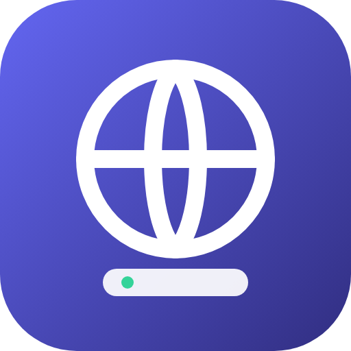
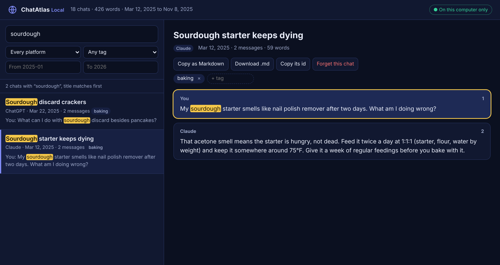

<p align="center"></p>

<h1 align="center">ChatAtlas Local</h1>

<p align="center">
Your ChatGPT and Claude chats, searchable on your own computer.<br>
Ask Claude about them. Nothing leaves your machine.
</p>

<p align="center">
<a href="https://github.com/hnt504/chatatlas-local/actions/workflows/ci.yml"></a>


</p>



You've had hundreds of conversations with AI assistants. The good answers, the decisions, the
half-finished plans are scattered across ChatGPT and Claude, and their own search barely helps.

ChatAtlas Local takes the data exports both of them already give you and keeps every chat in one
file on your computer. Then you can:

- **Search everything at once**, from the terminal or in your browser.
- **Ask Claude about it**: "what did ChatGPT tell me about my sourdough starter?" or "find the chat
  where I planned the garden beds." Claude Desktop, Claude Code, Cursor, VS Code and others can
  read your archive through MCP.
- **Keep it forever**, as plain Markdown files or a backup, whatever happens to the apps.

No account, no server, no telemetry. It never connects to the internet.

## Get started

You need [Node.js](https://nodejs.org) 22.16 or newer (or 24). Then:

```sh
npm install -g chatatlas-local
```

<sub>Before the first npm release, install it straight from GitHub: `npm install -g github:hnt504/chatatlas-local`</sub>

### 1. Ask for your exports

- **ChatGPT:** Settings → Data controls → Export data. You get an email with a link to a .zip.
- **Claude:** Settings → Privacy → Export data. Same idea: an email, then a .zip.

### 2. Bring them in

```sh
chatatlas-local import ~/Downloads/<your ChatGPT export>.zip ~/Downloads/<your Claude export>.zip
```

```
✓ 6720ab…-2026-10-21.zip: ChatGPT, 1,284 chats (1,284 new)
✓ data-2026-10-21.zip: Claude, 412 chats (412 new)
```

Do it again whenever you like with a newer export: new chats come in, changed ones update, nothing
doubles up. Or let it happen by itself (see [Exports folder](#an-exports-folder)).

### 3. Look around

```sh
chatatlas-local search sourdough starter
chatatlas-local open            # the browser view in the screenshot above
```

## Connect Claude (and friends)

### Claude Desktop

Either download `chatatlas-local-<version>.mcpb` from the
[latest release](https://github.com/hnt504/chatatlas-local/releases/latest) and open it with
Claude Desktop (it asks where your exports go; no terminal needed), or, with the command
installed:

```sh
chatatlas-local setup claude-desktop --write
```

Quit Claude Desktop completely and open it again. Then ask it something like *"Search my old chats
for the kitchen remodel estimate."*

**About the red warning.** When you open the extension, Claude Desktop says installing it "will
grant this extension access to everything on your computer." It says that for every extension
installed from a file rather than from Anthropic's directory, because an extension is a program
that runs as you. Here's what this one actually does: it reads your exports and its own archive
file, never connects to the internet, and gives Claude read-only tools. The code is all here to
check.

### Claude Code

Install it as a plugin (the MCP tools and a skill that teaches Claude when to look here):

```
/plugin install chatatlas-local --marketplace hnt504/chatatlas-local
```

Or, with the command installed:

```sh
chatatlas-local setup claude-code --write   # the MCP tools, for every project
chatatlas-local skill                       # teaches Claude Code when to look here
```

### Cursor, VS Code, Windsurf, Gemini CLI, Codex

```sh
chatatlas-local setup                 # shows each app's settings, and whether it's connected
chatatlas-local setup cursor --write  # or vscode, windsurf, gemini-cli, codex
```

`--write` keeps a copy of the app's old settings file next to it before changing anything.

### What about ChatGPT?

ChatGPT can't reach a file on your computer, so it can't read your archive here. You can still
import your ChatGPT exports and search them from Claude, the terminal or the browser view.

## What the assistant can do

Everything is read-only. An assistant can find and read your chats; it can't change, tag or delete
anything.

| Tool | What it does |
| --- | --- |
| `search_chats` | Chats holding every word you asked about, with the best-matching message quoted |
| `list_chats` | Browse by platform, date, words in the title, or tag |
| `read_chat` | Read a conversation message by message (long ones a page at a time) |
| `recent_topics` | What you talked about over a stretch of days, week by week |
| `archive_overview` | What the archive holds and how far back it goes |

## An exports folder

Point ChatAtlas Local at a folder (your Downloads, say) and any ChatGPT or Claude export you save
there comes in by itself. Other files are left alone, and each file is only read once.

```sh
chatatlas-local watch ~/Downloads                              # until you press Ctrl+C
chatatlas-local setup claude-desktop --inbox ~/Downloads --write  # whenever Claude Desktop is open
```

The Claude Desktop extension asks for this folder when you install it.

## Commands

| Command | |
| --- | --- |
| `import <file...>` | A ChatGPT or Claude export (the .zip, its `conversations.json`, or the unzipped folder), or a ChatAtlas backup |
| `search <words...>` | Chats holding every word. Each word also finds longer words it starts ("plan" finds "planning"); accents don't matter |
| `list` | Newest first |
| `show <id>` | Read one chat. `--md` for Markdown, `--json` for the data. The start of an id is enough |
| `topics` | What you talked about lately (`--days 90`) |
| `stats` | Chats per platform, chats per month, your tags |
| `open` | The browser view. `--read-only`, `--port 8765`, `--no-browser` |
| `tag <id> <tag...>` | Tag a chat (`--remove` takes tags off) |
| `forget <id...>` | Take chats out of the archive |
| `export <folder>` | Every chat as a Markdown file, or `--format chatatlas` for one backup file |
| `watch <folder>` | Bring in exports saved there, and keep watching |
| `setup [app] [--write]` | Connect an assistant |
| `skill` | Install the Claude Code skill |
| `doctor` | Check Node, the archive, the search index and every connected app |
| `where` | Where the archive file is |

Filters for `search`, `list`, `export` and `topics`: `--platform chatgpt`, `--tag work`,
`--since 2025-03`, `--until 2026`, `--title garden`, `--limit 50`, `--offset 50`, `--json`.

## Privacy policy

ChatAtlas Local is a program that runs on your computer. It has no servers and no accounts.

- **What it collects:** nothing. It has no analytics, telemetry or crash reporting, and never makes
  a network connection.
- **What it stores, and where:** the chats from the exports you import, plus any tags you add, in
  one SQLite file on your computer: `~/.chatatlas-local/chatatlas.db` (`chatatlas-local where`
  says exactly where). Use another with `--db <file>` or the `CHATATLAS_LOCAL_DB` setting. It reads
  your export files and doesn't change or delete them.
- **Sharing:** ChatAtlas Local shares nothing with anyone, including its author. If you connect an
  AI assistant (Claude Desktop, Claude Code, Cursor and so on), that assistant can search and read
  your archive through read-only tools when you ask it to, and what it reads becomes part of your
  conversation with it, under that assistant's own privacy policy.
- **The browser view** listens on `127.0.0.1` only, answers only requests addressed to it, and every
  request needs a random key that only the tab it opened knows.
- **How long it's kept:** until you delete it. `chatatlas-local forget <id>` removes a chat;
  removing the `~/.chatatlas-local` folder removes everything. Your ChatGPT and Claude accounts are
  never touched.
- **Installing:** npm (or GitHub, for the Claude Desktop extension) serves the download under its
  own terms; after that, nothing goes over the network.
- **Contact:** questions go to [GitHub issues](https://github.com/hnt504/chatatlas-local/issues);
  anything that could expose someone's chats goes privately through
  [security advisories](https://github.com/hnt504/chatatlas-local/security/advisories/new).

## ChatAtlas Local and ChatAtlas Pro

ChatAtlas Local is free and open source, and stays that way.
[ChatAtlas Pro](https://chatatlas.pro) is the hosted version, for people who want more:

| | Local | Pro |
| --- | --- | --- |
| ChatGPT and Claude exports | ✓ | ✓ |
| Search by words | ✓ | ✓ |
| Claude Desktop, Claude Code, Cursor and more | ✓ | ✓ |
| Your data stays on your computer | ✓ | Kept in your account |
| Gemini, Grok, Perplexity, DeepSeek and more | Through a ChatAtlas backup | ✓ |
| Search by meaning | | ✓ |
| ChatGPT and claude.ai on the web | | ✓ |
| Folders, projects, any device | | ✓ |

They speak the same backup format: `chatatlas-local export <folder> --format chatatlas` makes a
file ChatAtlas Pro imports, and a ChatAtlas backup comes into ChatAtlas Local the same way.

## Questions

**Which Node do I need?** 22.16 or newer, or 24 and up (23 won't do), because ChatAtlas Local uses the SQLite database built
into Node. `chatatlas-local doctor` checks.

**A chat I had yesterday isn't there.** The archive holds what was in the exports you imported.
Ask for a fresh export and import it (or drop it in your exports folder).

**Can it read exports from Gemini or other apps?** Not directly yet. ChatAtlas backups can carry
chats from any platform, and support for more exports is welcome as a pull request.

**How big does it get?** About the size of the exports' text. A 60 MB export of 3,000 chats
imports in about two seconds and searches in well under a tenth of a second.

## Contributing

Bug reports and pull requests are welcome. See [CONTRIBUTING.md](CONTRIBUTING.md).

## License

[MIT](LICENSE). Made by Heather Turner, who also makes [ChatAtlas](https://chatatlas.pro).
